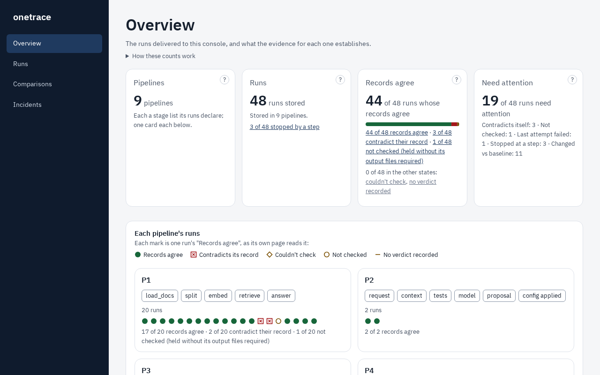
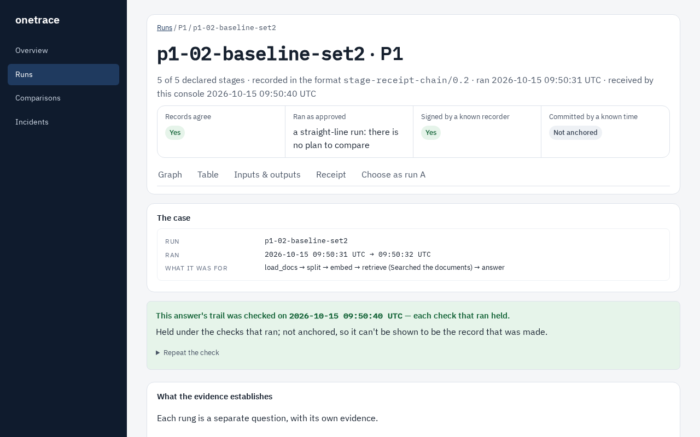
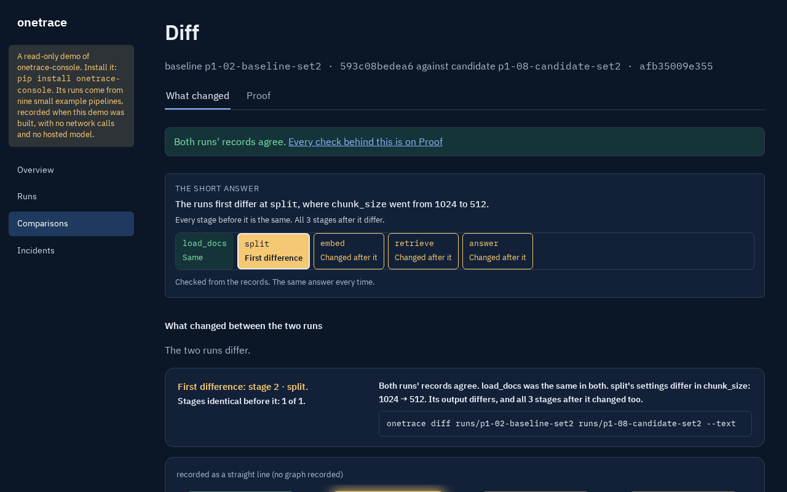

# onetrace-console

A local web console for runs recorded with [onetrace](https://oneproof.dev/onetrace/): every run in one place, each one checked by the verifier, and any two compared stage by stage.

The console never computes a verdict of its own. It keeps each run's files exactly as they were written, runs `onetrace-verify` and the SDK's own `diff` over them, and shows what those report. If the console and the run folder ever disagree, the folder is right.

## Install

```
pip install onetrace-console
```

It needs Python 3.12 or later. It installs from PyPI alone: `onetrace` 0.6.0 and `onetrace-verify` 0.6.0, with the `[crypto]` extra so signatures and anchors are checked. The pages' viewer ships inside the package.

`pip install onetrace-explain` makes the Explain button on the local console's comparison page work: the console runs that command, which sends a packet of the comparison to the model you name, and its format is set out at [explain-format.md](https://oneproof.dev/onetrace/explain-format.md).

## Upgrading from 0.4

- Comparisons made by an earlier console keep their pages and links. The same pair compared again under 0.5.0 gets a new name, and both are kept.
- An incident's page has a new address; the old address no longer answers.
- A comparison's name takes in the onetrace build that made it. A plain `pip install` names that build by the files its wheel carries, the same in every venv; an install pinned with `tools/install_pinned.py` names it by the wheel's sha256. So a pinned install and a plain one name the same comparison differently.

Every change is in [CHANGELOG.md](CHANGELOG.md).

## See it with the demo's runs

```
onetrace-console demo
```

This records the demo's runs into `onetrace-console-demo/` under the folder you start it from, starts the console, loads them, stores 15 comparisons, and prints the pages' addresses. The runs come from 11 small example pipelines that ship with the console: a question-and-answer pipeline over an example shop's refund policy, the reference demo's coding agent, a support-ticket triage, a support reply drafted by a stub whose wording varies from run to run, a supplier's invoice matched against its purchase order and goods receipt to paying or holding it, each payment or hold citing the decision that allowed it, an agent whose one step calls a sub-agent's run (the sub-agent's runs are a pipeline of their own), and four over physical readings: a pump's vibration to a maintenance work order, a camera frame of a bottle to a fill-level reject, a temperature logger to releasing or quarantining a shipment, and a tightening tool's wheel-bolt torques to passing a wheel or sending it to rework. The draft names the refund window in words; a later policy stage puts in the number of days. Every reading, ticket, invoice, decision and name in them is invented example data, and the demo records and compares; it controls no equipment and pays nothing. They make no network calls and use no hosted model: the embedder is a hashed bag of words, the answerer quotes the text it retrieved, and the times in the records are the times you ran it. 11 of its runs are broken on purpose when the demo is built; the read-only demo's Overview lists each one, with what was done to it and what its own page reads. The demo keeps its store and its trust file in that folder too. It runs in local mode, so it refuses to start while `ONETRACE_CONSOLE_CONFIG` is set.



A read-only copy of the demo is hosted at https://demo.oneproof.dev. To try the read-only mode yourself, run `onetrace-console demo --public`.

### Building the read-only demo

`onetrace-console demo --public --build FOLDER` builds the read-only demo into a new folder and exits; the hosted copy is one such build. Three options go with it:

- `--runs-from FOLDER` takes an earlier build's runs and trust file, where that build's record vouches for every byte.
- `--explanations FOLDER` keeps the explanations under `FOLDER/explain/` of comparisons this build holds, read-only.
- `--site-links FILE` names the public site's links into the demo, one per line. A listed comparison page the build names anew (a comparison's name takes in the SDK build that made it) gets a page at its old name, "This comparison has moved", sending a reader to the page between the same two runs. A listed link the build cannot place stops the build, with the link named.

## Your own runs

```
onetrace-console <runs folder>
onetrace-console <runs folder> --compare <run A> <run B>
onetrace-console <runs folder> --open
onetrace-console <runs folder> --trust <file> --tsa-cert <file> --tsa-root <file>
```

- `onetrace-console <runs folder>` loads every run folder in it: every folder holding a `MANIFEST.json`. It compares nothing unless you ask.
- A run folder is skipped, with the reason, while the others load: a run still being recorded (it holds onetrace's `.lock`), a folder that holds a link, or a folder whose `SHA256SUMS` doesn't match its files.
- `--compare A B` compares two of them, named by their folder names; A is the baseline.
- `--open` opens the console in your browser.
- `--port N` listens on port N, here and for `demo`. The default is 8080.

### Watching the folder

While the console runs, it reads the runs folder again every 2 seconds and takes in each new run once it has finished writing: once the run folder holds a `MANIFEST.json`, no `.lock`, and the same files at the same sizes on two reads in a row. A run still being recorded is not shown until then.

- The Overview and the list of every run say which folder is watched and when it was last read. When new runs have been taken in since the page was drawn, the page says so, with a link to show them; it doesn't reload by itself.
- A run is taken in once. If its folder changes afterwards, the stored copy stays as it was recorded and the page says the folder now differs; a run folder deleted afterwards stays in the store, with a note that it is no longer in the folder.
- Started on a folder with no finished run in it, the console waits for one. `--compare A B` naming a run folder that isn't there yet waits too, and the comparison is made when both have arrived.
- The folder is read by polling, the same way on Windows, macOS and Linux.
- `--watch-interval N` reads it every N seconds instead. `--no-watch` reads it once, at start, and not again; a folder with no run folder in it is then refused.

### Signing and anchoring

- `--trust FILE` names the signing keys you trust, in an `onetrace-trust/0.1` file. A run signed with one of them reads "Signed by a known recorder: Yes", with that key's label from the file. Without `--trust`, a signed run reads "Signed, key not trusted".
- `--tsa-cert FILE` and `--tsa-root FILE` name the RFC 3161 time-stamp authority you trust and the root its certificate chains to. They go together; `--tsa-root` may be given more than once. With them, a run's anchor is checked, and "Committed by a known time" reads Yes when the check holds. Without them, an anchored run reads "Couldn't check", and the page names the two options to add.
- Every check runs with these files, and a stored check records which ones it ran with. Started again with the same files, nothing is checked again; with different ones, every run is.
- A file that can't be read is refused at start, with how to fix it.





## What it shows

- **Each run:** the verifier's result and every row it reported, the run's stages, and its receipt, including whether it is signed and anchored.
- **Gated steps:** where a run declares a gated step or cites a decision, "Action authorized, effect confirmed" gives the combined result of onetrace-verify's `decisions:` rows (any FAIL is No, all PASS is Yes, otherwise couldn't check), their counts, each row that is not PASS by name, and a link to the run's Gated steps section.
- **Two runs compared:** the stage-by-stage comparison `onetrace diff` produces, and the text that changed, as the SDK reports them.
- **Counts:** the Overview opens with its four count cards; every number says what it counts and links to the exact runs behind it.
- **Span context:** a run's traceparent, trace id and span id are pointers into the app's own tracing tool. Where the console's configuration file names one, as `"tracing": {"link": "https://your-tool.example/trace/{trace_id}?span={span_id}"}`, each trace id links to it there; the console builds the link and never calls it. A public console links to none.

## Model-call records

A step's model-call records in `model-call-record/1.0` (`model_call.json`, then `model_call.2.json` and on) are read by the installed onetrace, which holds each one to the format; the console keeps no copy of the format.

- Each field is shown as the record states it, in the record's order, under the format's own groups ("The call", "The runtime", "The batch", ...), with the format's description of it one fold away.
- Where a record names its per-step capture, the steps file is read (its bytes must match its receipt and the digest the record names) and drawn as a token timeline: one row per decode step, each chosen token as an id, never decoded to text.
- On a comparison page, each step where both runs hold a record of the same name shows onetrace's comparator's report line for line: `same`, `diverged` naming the first field, or `could not compare` naming each condition.
- A record that names its model files (`model.files_digest`) lists the other runs whose records name the same value, each linked to its record.
- A record in the earlier draft format, or an output named like a record that 1.0 does not name, is named with its reason and not shown. A run whose records are in the draft format says so in one line: recorded by an earlier release, and kept as it was recorded.

## Searching the runs

The console keeps an exact index of the runs, `run_index.json`, beside the store. It is rebuilt from the records whenever the console draws its pages, and holds no text: no kept input is read. The search box on the Runs page and on each run's page asks it by recorded field:

`setting:<step>.<name>=<value>` (`*` for any step), `input:<name>=<digest>`, `inputs:same-as:<run>`, `first_diff:<step>`, `first_diff:any:<setting|input|configuration|output>`, `diff:same-as:<run>`, `verdict:`, `row:"<name>"=<FAIL|NOT-RUN>`, `model:<field>=`, `engine:`, `gated:`, `pipeline:`, `since:<run>`, `benchmark:yes|no`.

Every term must match. Each result shows the fields that matched, as recorded, and "Compare with this run". A search runs nothing.

## Benchmarks, references and verdicts

- **Benchmarks.** On a local console, a run's page has "Mark as benchmark", with an optional note, and its undo: a person vouches for the run as the one to compare against. The mark (who, when, the note) is kept in the console's store, never in the run's record. A "benchmark" badge shows wherever the run is listed. The badge never says "correct", and no verdict, rung or count reads differently for a marked run.
- **"What changed?"** takes a benchmark first at each of its rules, and names the rule it used.
- **The reference.** A pipeline's reference is made by `onetrace reference make` from its benchmark (the one marked most recently, where it has more than one) and that benchmark's repeats, and never from a run whose records could not be checked. Marking a run moves its pipeline's reference, and every verdict in the pipeline is then read against the new one; the page says so beside the mark and its undo.
- **Verdicts.** Each run's page shows `onetrace verdict` against the reference line for line, with the reference's seal, what it was made from and how it was chosen. The Runs list shows each run's word beside "against the reference" and the seal. A run whose own records could not be checked gets no word.
- **A benchmark's variation profile.** Where a benchmark was recorded again on the same configuration, its page shows `onetrace profile` over it and its repeats: counts only, in onetrace's order, with its two non-claims.
- **Verdicts as runs arrive.** On a local console, a page over each pipeline with a reference, linked from the Runs page: how many of its runs read each of onetrace's words, then its latest runs, newest first. Counts only, no threshold, no alert.

A public console runs none of these: its benchmarks, references and verdicts are its build's.

## Compare on the public demo

A pipeline's page on a public console has a picker of two of its runs. Compare takes exactly the two run ids and nothing else, and compares the pair with the SDK's verbs on the two runs as recorded, with no model and no explanation. A pair compared before opens at once and runs nothing. The pages are kept in a folder beside the built store (`compare_cache`, by default `<store root>/compared`), which the build record does not cover.

It is bounded: one comparison in flight per client address with two waiting, two running at once, at most 20 started a minute for the whole console (over it the page says "Busy, try again" and nothing is queued), and each verb stopped after 30 seconds, its comparison then not kept. Each bound is a configuration key (`compare_per_minute`, `compare_running`, `compare_queue`, `compare_wait_seconds`, `compare_verb_seconds`) that can lower it, not raise it. `compare_client_header` names the proxy's client-address header, and is refused on any console that is not public. Its log line holds the pair, the outcome and the time taken, and no address.

## What it does not show

Nothing here says which version is correct, who changed the source, or why.

A run's record does not show:

- that the output or the action was correct;
- why the model wrote what it wrote;
- that the signing key wasn't misused (your trust list is what ties a key to a name);
- that the run was correct at the anchored time (the anchor shows only that the record existed by then).

## Neighbours by input (optional, local only)

```
pip install "onetrace-console[neighbours]"
```

This optional extra suggests, on a local console, other runs of the same configuration whose kept inputs are near a run's own, and, on a comparison of two of them, a nearness ladder beside the exact one. It is off until you turn it on at `/neighbours/setup` on the console, and it never runs on a public console, the hosted demo among them.

Turning it on with one of the two local models fetches that model's pinned files once from huggingface.co, at the pinned revision, and checks each file against its pinned sha256 before it is kept. Nothing else is fetched, and no text leaves the machine: the kept inputs and outputs are embedded on it. If you name an embedding endpoint of your own instead, the kept inputs and outputs are sent to that endpoint, and nothing is fetched.

In the ladder, "1.00 by the record" means the two runs' digests for that file are equal, so nothing is embedded there. "≥ 0.9995, digests differ" means the digests are not equal and the embedder's number rounds to 1.000. Every other number is the embedder's, to three places. Neither is a judgement that two runs did the same thing: nearness is the embedder's reading of the kept inputs and outputs, and the exact comparison beside it is the record.

## Where it runs

Started as above, it listens on 127.0.0.1 only; `--open` asks your browser to open the local page. The console makes no network calls but those you choose. The Explain button runs onetrace-explain, if you install it, and that command sends an evidence packet to the model you configure. The first time it would send a kind of item it has never sent to that endpoint, it lists them and asks first. Turning on neighbours by input with a local model fetches that model's pinned files once from huggingface.co, as above. Turning it on with an embedding endpoint of your own sends that endpoint the kept inputs and outputs. A folder load keeps what it stores in a `store` folder under the folder you start it from, and `demo` keeps it in `onetrace-console-demo/`.

To run it for a team, as a container with sign-in, see [OPERATOR_README.md](OPERATOR_README.md).

## For contributors

On Windows, run the test suite from a short path (for example `C:\src\oc`), or turn on long paths: some of the files the suite writes have paths longer than Windows' 260-character limit.

## Licence

Copyright 2026 Shamik Saha. Licensed under Apache-2.0; see LICENSE.

The bundled IBM Plex fonts are under the SIL Open Font License 1.1.
